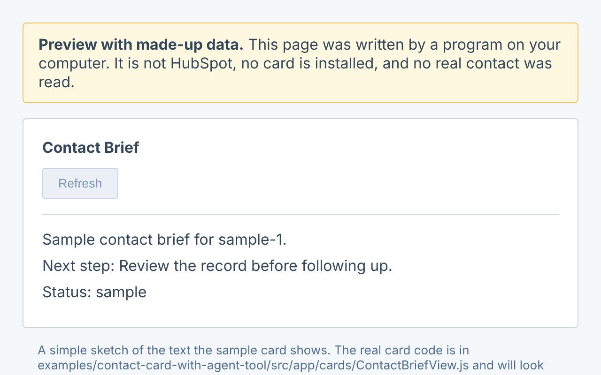

# HubSpot Contact Card AI Starter

Build a small panel for a HubSpot contact that shows a short brief and a suggested next step.

> [!NOTE]
> **A guided starter, not a production integration.** You can practice without
> a HubSpot account or credentials. To test inside HubSpot, use a developer
> test account with made-up records.



*Local preview with made-up data, not a card installed in HubSpot.*

## Pick Your Path

- **New to coding:** [Follow the walkthrough](docs/start-here.md), including what to install and where to type commands.
- **Building with AI:** Paste the message below into your assistant. The [full AI walkthrough](START_WITH_AI.md) explains what to do if it can't open the repo or run commands.
- **Developer:** [Code map](docs/developer-architecture.md) | [Data contract](docs/contracts/contact-card-data-contract.md) | [Example files](examples/contact-card-with-agent-tool/README.md).

## Start With AI

Copy this into your AI chat. Add your goal in plain English if you already have one.

```text
Help me use this HubSpot learning starter: https://github.com/Jai-HS-Dev/hubspot-contact-card-ai-starter
Read START_WITH_AI.md and AGENTS.md. If you can't open them, tell me how to share the public starter files.
Ask what I want to do, then guide me through one local example with made-up data.
Don't ask for secrets, connect an account, or deploy anything. This is a prototype, not a production integration.
```

## Try It Locally

Install [Node.js 22 or newer](https://nodejs.org/en/download) if you don't have it.
On GitHub, choose **Code > Download ZIP**, extract it, and open a terminal in
the folder with this README. No project packages need to be installed for this step.

```bash
npm run doctor
npm run smoke:example
```

In Windows PowerShell, use `npm.cmd` instead of `npm`.

**Success looks like:** `card smoke example passed.`

To see it as a page, run `npm run preview` and open the file it names.

## Make It Yours

1. **Practice:** [Try the worked exercise](docs/worked-example.md). Change a label and check the card's sample, empty, and error states.
2. **Verify in HubSpot when ready:** [Try the card on one test contact](docs/first-live-test.md) in a HubSpot developer test account. The local preview does not install the card or verify request signing.
3. **Before real use:** Review the [live-use checklist](docs/REAL_TOOL_CHECKLIST.md). Approve the account, permissions, and action first. Never paste secrets into chat or commit them.

Use this starter for something a person should see on a CRM record. For a tool an agent calls without a card, [pick the agent-tools starter](docs/choose-your-path.md). Use [HubSpot's project templates](https://github.com/HubSpot/hubspot-project-components) for the app scaffold and [HubSpot's card examples](https://github.com/hubspotdev/ui-extensions-examples) for interface ideas.

No specific AI editor or hosting provider is required. For account and authentication choices, see the [connection guide](docs/connect-to-hubspot.md). [AGENTS.md](AGENTS.md) gives assistants instructions; it does not control their permissions.

## Tests And Help

`npm run test:core` works without packages. The [example setup](examples/contact-card-with-agent-tool/README.md) explains how to run the full UI suite after reviewing and approving its dependencies. See [what was tested](docs/EVIDENCE.md), [troubleshooting](docs/troubleshooting.md), and the [plain-language glossary](docs/glossary.md). [Support](docs/SUPPORT.md) is best-effort. Use the [security policy](SECURITY.md) to report security issues without exposing private data.

## License And Responsibility

[MIT License](LICENSE). This independent project is not endorsed by HubSpot.
The examples are not security-audited and are provided as is, without warranty. You are responsible for
[validating, securing, and operating what you build](docs/implementation-responsibility.md).
